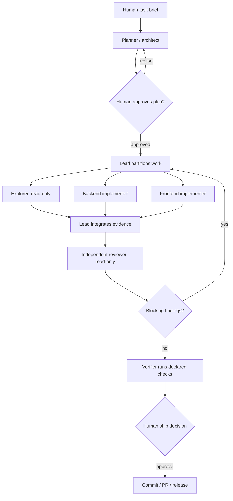

# Agentic Dev Orchestrator

A repository-native operating system for planning, delegating, reviewing, and shipping software with coding agents.

This is not a collection of generic prompts. It is an inspectable set of project instructions, specialist agents, reusable slash workflows, living execution plans, task contracts, and evidence rules that can be dropped into a real codebase.

## What it proves

- Persistent instructions shared across Codex and Claude Code
- Bounded delegation to specialist agents with deliberately limited tools
- Plan approval before multi-file or high-risk implementation
- Separate implementation and review contexts
- Explicit ownership boundaries for parallel work
- A durable paper trail from brief to plan, review, handoff, and outcome
- Honest verification: commands actually run are separated from checks not run

The workflow is designed to complement real projects, not replace them. See [Bitewiz](https://github.com/ByteBoyy/bitewiz) for a shipped voice/LLM system and [CareMate](https://github.com/ByteBoyy/caremate) for application-level database, API, UI, and document workflow ownership.

## Operating model



Parallel work is used only when ownership can be split by files or components. Sequential or overlapping work stays in one context.

## Repository map

```text
AGENTS.md                    Shared, tool-neutral operating instructions
CLAUDE.md                    Claude entrypoint; imports AGENTS.md
.agent/PLANS.md              Contract for self-contained living ExecPlans
.claude/agents/              Reusable specialist subagents
.claude/skills/              /plan, /orchestrate, /review, /handoff, /ship
.claude/rules/               Always-on security and evidence rules
plans/                       Versioned, resumable execution plans
templates/                   Task, review, and handoff contracts
examples/                    Completed artifacts from real repository work
scripts/audit_config.py      Static audit of the orchestration configuration
```

## Use it

1. Copy the relevant files into a repository root.
2. Replace the sample commands and ownership boundaries in `AGENTS.md`.
3. Start Claude Code in that repository and confirm `CLAUDE.md` appears in `/context`.
4. Invoke `/plan <outcome>` for a substantial change.
5. Invoke `/orchestrate plans/<plan>.md` after the plan is accepted.
6. Run `/review`, then `/handoff`, then `/ship`.

Claude Code currently treats project skills as slash commands. The legacy `.claude/commands/` path still works, but this repository uses the recommended `.claude/skills/<name>/SKILL.md` structure.

Codex reads `AGENTS.md` directly. Claude Code reads `CLAUDE.md`, which imports `AGENTS.md` using its supported `@AGENTS.md` syntax so the shared rules have one source of truth.

## Inspect the paper trail

The bootstrap of this repository is recorded as a living plan in [`plans/0001-bootstrap-orchestrator.md`](plans/0001-bootstrap-orchestrator.md). The related brief, review, and handoff are under [`examples/0001-bootstrap`](examples/0001-bootstrap).

Run the configuration audit:

```bash
python3 scripts/audit_config.py
```

The audit checks structure and frontmatter. It does not claim that a model followed the instructions; behavior still requires observation and human review.

## Design boundaries

- Instructions guide model behavior; they are not a security boundary.
- Agent-team runtime state is not committed. Claude creates `~/.claude/teams/` and `~/.claude/tasks/` itself.
- Agent teams are experimental and opt-in. The default workflow uses focused subagents.
- No agent is allowed to claim test, build, deployment, or review evidence it did not observe.
- Destructive actions and external side effects remain human-approved.

## Sources behind the structure

- [Claude Code project memory and `CLAUDE.md`](https://code.claude.com/docs/en/memory)
- [Claude Code skills and custom slash workflows](https://code.claude.com/docs/en/slash-commands)
- [Claude Code custom subagents](https://code.claude.com/docs/en/subagents)
- [Claude Code agent teams](https://code.claude.com/docs/en/agent-teams)
- [OpenAI `AGENTS.md` guide](https://developers.openai.com/codex/guides/agents-md)
- [OpenAI Cookbook: execution plans](https://github.com/openai/openai-cookbook/blob/main/articles/codex_exec_plans.md)

## Author

**Omar Ashraf** — AI and full-stack engineer working across agent systems, Python/FastAPI, LLM tooling, and production application delivery.
